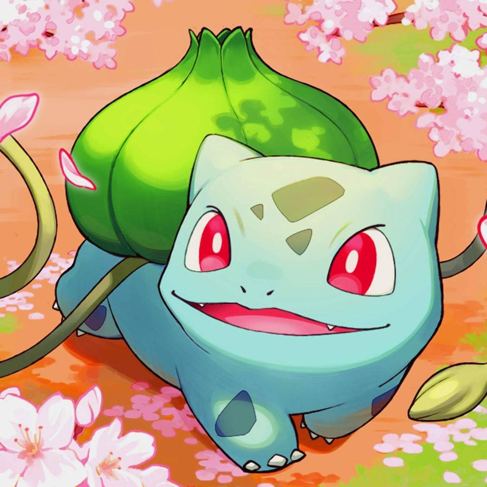

# Bulba

An Obsidian theme. Bulba is a fork of [Primary](https://github.com/primary-theme/obsidian) by Cecilia May ([Ko-fi](https://ko-fi.com/ceciliamay)), with its own palettes and a modular SCSS build.

## Inspiration

The palette is heading toward this picture: aqua-teal skin, deep teal spots, a bright green bulb, red eyes, and blossom pink and peach as accents. The light mode's seafoam neutrals and teal text come from the skin; the [Four Winds](https://github.com/PoweredbyPugs/four-winds) compass graph takes its node colors from the spots, bulb, eyes, and ground.

The artwork is Bulbasaur fan art found on DeviantArt. The artist isn't identified here; credit or removal on request.

## Install

Copy `manifest.json` and `theme.css` into `<vault>/.obsidian/themes/Bulba/`, then pick Bulba under Settings → Appearance → Themes.

Most options are exposed through the [Style Settings](https://github.com/mgmeyers/obsidian-style-settings) plugin.

## Build

The source lives in `src/` as SCSS partials and compiles to a single `theme.css`.

| Command | Description |
|---------|-------------|
| `npm install` | Install sass (first time only) |
| `npm run build` | Compile `src/main.scss` to `theme.css` |
| `npm run dev` | Rebuild on save |
| `npm run set-bg -- <image>` | Swap the new-tab background image (needs ImageMagick and Python 3) |

## License

GNU General Public License v3, the same as Primary. See [LICENSE](LICENSE).
